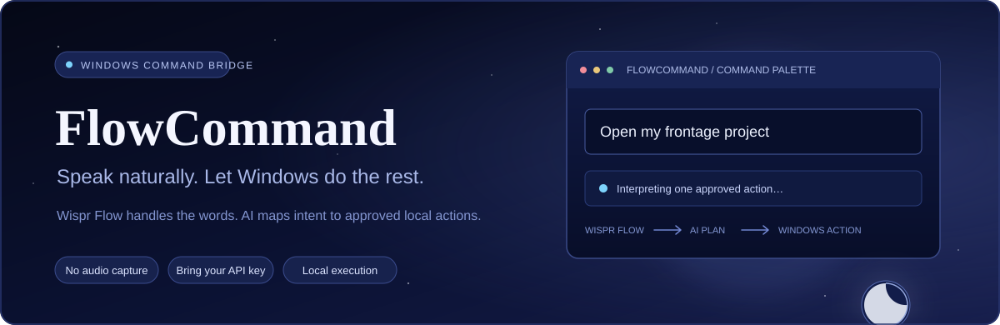
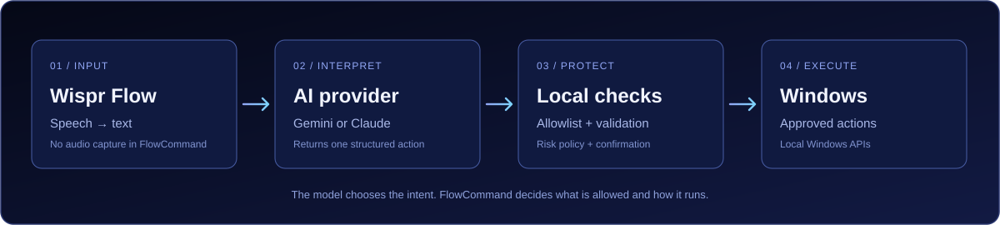

<div align="center">



### Speak naturally. Let Windows do the rest.

FlowCommand turns **Wispr Flow's text output** into structured, AI-interpreted commands for Windows — without building another speech-recognition engine or keeping a microphone open.

<p>
  
  
  
  
  
  
</p>

<p>
  <a href="https://github.com/LwkMoon/FlowCommand/releases/latest">Downloads</a>
  &nbsp;·&nbsp;
  <a href="#quick-start">Quick start</a>
  &nbsp;·&nbsp;
  <a href="#what-it-can-do">Commands</a>
  &nbsp;·&nbsp;
  <a href="docs/commands.md">Full command reference</a>
  &nbsp;·&nbsp;
  <a href="#configuration">Configuration</a>
  &nbsp;·&nbsp;
  <a href="#safety-and-privacy">Safety &amp; privacy</a>
</p>

</div>

---

## What is FlowCommand?

**Wispr Flow is the input. FlowCommand is the action layer.**

Wispr Flow already does the difficult part: turning speech into clean text. FlowCommand takes that text, asks an AI provider to identify the intended Windows action, validates the response locally, and runs only an action that is explicitly supported by the application.

There is no second speech-recognition engine, no microphone capture inside FlowCommand, and no always-listening voice assistant. A small command palette receives the text that Wispr Flow inserts into it.



### The idea

1. Open the FlowCommand palette by double-tapping the **backtick** key (the one to the left of **1**).
2. Use the normal Wispr Flow hotkey and speak naturally.
3. Wispr Flow inserts the transcript into the palette.
4. Gemini or Claude maps the text to one structured action.
5. FlowCommand validates the action, checks its local risk policy, and runs it when allowed.

For example:

| Say | FlowCommand interprets |
|---|---|
| “Open Chrome” | Launch the configured browser |
| “Switch to VS Code” | Bring the VS Code window forward |
| “Open my downloads” | Open the Windows Downloads folder |
| “Open my FrontAge project” | Open a configured project in its editor |
| “Turn Bluetooth off” | Request Bluetooth off and verify the result |
| “What's using port 3000?” | Inspect the TCP listener on port 3000 |
| “Pause the music” / “turn it up a lot” | Press the media play/pause or volume keys |
| “Open GitHub” | Open a configured website |
| “Search for the best pizza near me” | Run a web search in your browser |
| “Take a screenshot” | Save a full-screen screenshot |

> **Wispr Flow is required.** FlowCommand is an independent companion application, not a replacement for Wispr Flow and not an official Wispr product or integration.

## Why FlowCommand?

Most voice-control tools bring their own speech engine, microphone handling, command interface, and setup. FlowCommand takes a smaller approach: use the dictation tool already installed and add a local, configurable action layer on top.

- **Use the dictation you already trust.** Wispr Flow handles speech recognition and transcript cleanup.
- **No microphone capture in FlowCommand.** The application receives text, not audio.
- **Bring your own AI key.** Choose Google Gemini or Anthropic Claude and enter your own API key.
- **Local action execution.** Windows actions are handled by the desktop application, not by a remote automation service.
- **Ready on day one.** 65 applications, 69 websites, 14 folders, and 36 Settings pages are built in. See the [command reference](docs/commands.md).
- **Configurable.** Add application aliases, websites, project folders, and named folders without changing code.
- **Safety checks stay local.** The model cannot invent a PowerShell command or bypass the action allowlist.
- **No telemetry.** FlowCommand has no analytics and no update check. Its only network traffic is the request to the AI provider you choose.

## What it can do

Everything below works with natural phrasing; you do not need exact wording. The complete list of built-in apps, websites, folders, and Settings pages is in the **[command reference](docs/commands.md)**.

### Application and window control

| Command | Action |
|---|---|
| “Open Chrome” | Launch an application |
| “Close Discord” | Ask all matching windows to close normally |
| “Switch to VS Code” | Activate a running application's window |
| “Minimise Chrome” | Minimise matching application windows |
| “Maximise this window” | Maximise the window that was active before the palette opened |
| “Restore this window” | Restore a minimised or maximised window |
| “Show desktop” | Minimise windows to reveal the desktop |
| “Bring my windows back” | Undo the show-desktop action |

Closing an application sends a normal Windows close request. It does not force-kill the process, so the application can still ask to save unsaved work. Core Windows components and Wispr Flow are protected and are never closed.

65 applications are built in, including browsers (Chrome, Edge, Firefox, Opera, Opera GX, Brave, Vivaldi), editors and IDEs (VS Code, Cursor, Notepad++, Visual Studio, JetBrains tools), terminals, Microsoft Office, chat and meeting apps, media and creative tools, game launchers, and Windows utilities such as Task Manager, Calculator, and Device Manager. Other applications are discovered from Windows Start Menu shortcuts or registered App Paths, or you can add your own.

Terminal entries (Windows Terminal, Command Prompt, PowerShell) only **open a window**. FlowCommand never types into them or runs commands in them.

### Websites and web search

- **“Open GitHub”, “open Gmail”, “open YouTube”:** opens a site from the `websites` list in your default browser, or in the browser you choose with `websiteBrowser`. 69 popular sites are built in, and you can add your own.
- **“Search for …”, “look up …”:** opens a web search using your `searchUrl` (Google by default; set DuckDuckGo or another engine if you prefer).

The AI never supplies a URL. Site addresses come only from your configuration, and a search sends only the words you said, percent-encoded into your own https template.

### Media, screenshots, and lock

| Command | Action |
|---|---|
| “Pause”, “next song”, “previous track” | Press the media play/pause, next, or previous key |
| “Volume up”, “turn it up a lot”, “mute” | Press the volume keys (about 2% per step; up to 25 steps) |
| “Take a screenshot” | Hide the palette and save a full-screen screenshot to *Pictures → Screenshots* |
| “Snip an area” | Hide the palette and open the Windows snipping selector |
| “Lock my computer” | Lock the Windows session |

Media keys behave like the buttons on a keyboard, so they control whichever player responds to them. Windows does not report the resulting state, so FlowCommand shows these as sent-but-unverified. Screenshots are checked: FlowCommand confirms that a new file appeared.

### Folders and projects

- Open built-in Windows folders: Downloads, Documents, Desktop, Pictures, Music, Videos, Home, Screenshots, OneDrive, AppData, Temp, Startup, the Recycle Bin, and This PC.
- Add named folders such as `invoices`, `school`, or `captures` in `config.json`.
- Register project directories and open them in a configured editor.
- Set a default application for a category, such as your default browser or editor.

### Windows settings and Bluetooth

FlowCommand can open 36 Windows Settings pages, including Bluetooth, Wi-Fi, network, VPN, airplane mode, Sound, Display, Night light, Notifications, Power, Battery, Storage, Installed apps, Default apps, Startup apps, Mouse, Typing, Printers, Privacy (including the microphone and camera pages), Accounts, Date & time, Language, Windows Update, Personalization, Background, Colours, Lock screen, Taskbar, Themes, Clipboard, Multitasking, Accessibility, Troubleshoot, and About.

Bluetooth is also a supported action: FlowCommand requests an explicit **on** or **off** state, then checks the reported state. If Windows or the adapter refuses the change, FlowCommand reports that it did not change Bluetooth and opens the Bluetooth settings page instead.

### Local development utilities

- **Inspect a TCP port:** identify the process and PID listening on a port.
- **Terminate a TCP listener:** force-terminate the process using a specified port. This is high-risk, shows a preview, and always requires confirmation.

### One command means one action

The current command model intentionally maps one dictated request to one action. Ambiguous requests produce a short clarification, and unsupported requests are reported as unsupported. Multi-step routines and arbitrary workflow execution are not part of the current action catalogue.

### Result icons

| Icon | Meaning |
|---|---|
| ✓ | Done, and FlowCommand checked the result. |
| ! | The request was sent, but Windows does not report back, so the result is unverified (media keys, opening websites). |
| ✗ | Failed or not allowed. The message says why, and nothing else was run. |
| ? | FlowCommand needs a clarification; dictate your answer. |
| ◌ | Dry run: this is what would have happened. |

## Requirements

- **Windows 10 version 1809 or newer** (Windows 11 is supported).
- **[Wispr Flow for Windows](https://wisprflow.ai/)** installed, configured, and working with its normal dictation hotkey.
- An API key for at least one supported provider:
  - [Google AI Studio](https://aistudio.google.com/) for Gemini.
  - [Anthropic Console](https://console.anthropic.com/) for Claude.
- **For the downloadable build:** nothing extra if you choose the *self-contained* archive. The smaller archive needs the [.NET 10 Windows Desktop Runtime](https://dotnet.microsoft.com/download/dotnet/10.0).
- **For building from source:** the .NET 10 SDK.

Each release offers two Windows x64 archives:

| Archive | When to choose it |
|---|---|
| `FlowCommand-<version>-win-x64-self-contained.zip` | **Recommended for most people.** Larger, but runs on a PC with nothing else installed. |
| `FlowCommand-<version>-win-x64.zip` | Smaller. Needs the .NET 10 Desktop Runtime installed. |

## Quick start

### 1. Download and launch

1. Open the [latest release](https://github.com/LwkMoon/FlowCommand/releases/latest).
2. Download an archive (see [Requirements](#requirements)) and extract it to a folder you control.
3. Optional: verify the download. Each release includes `SHA256SUMS.txt`; compare it with the result of `Get-FileHash .\<archive>.zip -Algorithm SHA256` in PowerShell.
4. Run `FlowCommand.exe`.
5. FlowCommand appears in the Windows system tray. On first launch, Settings opens so an AI provider can be configured.

FlowCommand is not code-signed, so Windows SmartScreen may show a warning the first time. Select **More info → Run anyway** if you trust the download source. If there is no release attached yet, build the application from source using the instructions in [Development](#development).

### 2. Add an AI provider key

In Settings:

1. Select **Gemini** or **Anthropic**.
2. Check or edit the model ID.
3. Paste your API key.
4. Select **Test AI (runs nothing)**.
5. Save the settings.

The test asks the provider to interpret a harmless sample request; it does not execute a Windows action.

FlowCommand uses your own API key. API usage, rate limits, data handling, and any charges are governed by the provider and the account associated with that key. An API subscription is separate from a consumer chat subscription where the provider makes that distinction.

The default Gemini model is `gemini-3.5-flash-lite`, which, at the time of writing, has a more generous free-tier allowance than the larger Flash models. If you see repeated *overloaded* or *timed out* errors, try another model in Settings; capacity varies by model and over time.

### 3. Try Dry-run mode first

For the first commands, enable **Dry-run mode** in Settings or from the system-tray menu. FlowCommand will interpret the request and show what it *would* do, but it will not execute the action.

Start with a simple test such as:

- “Open Chrome”
- “Open my Downloads folder”
- “Show desktop”

Once the result is what you expect, turn Dry-run mode off.

### 4. Open the palette and dictate

The default trigger is **double-tapping the backtick key** — the key to the left of **1**, printed `` ` `` and `~`.

1. Click the desktop or another area that does not have a text field focused.
2. Double-tap the backtick key.
3. Wait for the FlowCommand palette to appear and focus its input.
4. Hold the usual Wispr Flow dictation hotkey.
5. Say a command, such as “Open Chrome”.
6. Release the Wispr Flow hotkey. The transcript is inserted into FlowCommand.
7. In the default `paste` mode, FlowCommand submits the inserted text after a short quiet period. Press Enter to submit immediately instead.

The palette stays open after an action so another command can be dictated. Press Escape to cancel a pending confirmation, clear the current input, or close the palette. Double-tap the trigger key again to close it too.

### 5. Check the text-field safeguard

When FlowCommand can positively identify a text input control, the double-tap is ignored. This is intended to keep normal typing and Wispr dictation in text fields from opening the command palette.

Focus detection is best-effort. Some browsers, Electron applications, games, remote-desktop clients, and custom controls do not always expose focus information consistently. See [Hotkeys and focus detection](#hotkeys-and-focus-detection) for the configurable behaviour and workaround.

## Hotkeys and focus detection

| Trigger | Behaviour |
|---|---|
| Double-tap the backtick key (default) | Opens or closes the palette, subject to the text-field focus check |
| Optional shortcut, e.g. `Ctrl+Alt+Space` | Always opens the palette, including when a text field has focus |
| System-tray menu | Opens the palette without using a keyboard shortcut |

### Choose the trigger key

Open Settings → **Trigger key**, or set `doubleTapKey` in `config.json`:

| `doubleTapKey` | Key |
|---|---|
| `backtick` (default) | The key left of **1**, matched by its physical position so it works on any keyboard layout |
| `capslock` | Caps Lock |
| `scrolllock` | Scroll Lock |
| `pause` | Pause/Break |

Set `doubleTapEnabled` to `false` to turn the double-tap off and rely on the optional shortcut or the tray menu.

### How the key listener behaves

The double-tap uses a Windows low-level keyboard hook, because a normal registered hotkey cannot detect a single key pressed twice. The hook checks whether each key event is the trigger key, and uses other physical key presses only to cancel an unfinished double-tap. It does not record, store, log, or forward typed characters, and it never blocks a key. Injected keyboard events, including Wispr's simulated input, are ignored.

Because the backtick is a typing key, a few consequences follow:

- Both taps still reach the application you are in, so a double-tap types two backticks there. In a text field the trigger is ignored anyway; on the desktop they are harmless.
- FlowCommand's own input box discards backticks, so they never end up in a command.
- Presses made while **Ctrl**, **Alt**, **Shift**, or **Win** is held never count, so shortcuts such as VS Code's Ctrl + backtick terminal toggle are safe.
- On a keyboard layout where that key is a *dead key* (for example US-International), the first press can combine with the next letter you type. Choose another trigger key if that bothers you.

### Configure a dedicated shortcut

Open Settings and enter a shortcut such as:

```text
Ctrl+Alt+Space
```

Supported modifiers are `Ctrl`, `Alt`, `Shift`, and `Win`. The final key can be a letter, number, function key, or one of the supported named keys. At least one modifier is required unless the final key is an F-key. If another application already owns the shortcut, choose a different combination.

### Focus detection behaviour

The double-tap checks for a text caret and Windows UI Automation information. When it detects a text input, the trigger is ignored. When focus is unknown, the current configuration can either allow the palette to open or ignore the trigger.

For a more conservative, fail-closed behaviour, set this in `config.json`:

```json
"openWhenFocusUnknown": false
```

The current default is `true`. Setting it to `false` may mean the double-tap occasionally does nothing in applications that do not expose focus information. The optional dedicated shortcut and tray menu remain available.

## Configuration

FlowCommand creates its configuration file on first launch:

```text
%APPDATA%\FlowCommand\config.json
```

The easiest way to find it is the system-tray menu → **Open config folder**. After editing the file, select **Reload config.json** in the same menu.

The configuration parser accepts JSON comments and trailing commas, so the included [`config.example.json`](config.example.json) can be used as a reference. It contains every built-in application and website, with comments.

### Add an application

Applications can be resolved from the Windows Start Menu and registered App Paths. Add an entry when you want a custom name, aliases, known executable paths, or reliable window-control support.

Add this object inside the existing `applications` section:

```json
"zotero": {
  "displayName": "Zotero",
  "category": "research",
  "processName": "zotero",
  "aliases": ["zotero", "my references"],
  "paths": [
    "%ProgramFiles(x86)%\\Zotero\\zotero.exe"
  ]
}
```

- `displayName` is the name shown in status messages.
- `aliases` are alternative names the AI can map to the application.
- `category` can be used with `defaultApps` (for example, `browser` or `editor`).
- `paths` lists executable locations. Environment variables such as `%LocalAppData%` are expanded.
- `processName` is the process name without `.exe`. Set it if the application should support close and window-management actions.
- `pathContains` can distinguish applications that share a process name (Opera and Opera GX do this).

Names and aliases must be unique across applications; a name that two apps share is reported as ambiguous. An application discovered only through a Start Menu shortcut may be launchable without a custom entry. Closing or managing its windows may require a configured `processName`.

### Add a project

Add a project inside the existing `projects` section:

```json
"frontage": {
  "path": "D:\\Projects\\FrontAge",
  "aliases": ["frontage", "front age"],
  "editor": "vscode"
}
```

The `editor` value must match an application ID in `applications`. If omitted, FlowCommand uses `vscode`.

Then say:

> “Open my FrontAge project.”

### Add a named folder

Add a folder inside the `folders` section:

```json
"invoices": "%UserProfile%\\Documents\\Invoices"
```

Environment variables are expanded. Then say:

> “Open my invoices folder.”

### Add a website

Add a site inside the `websites` section. Only `http` and `https` addresses are accepted:

```json
"my dashboard": "https://example.com/dashboard"
```

Then say “open my dashboard”. To open sites in a particular browser, set `websiteBrowser` to an application ID such as `"chrome"`; leave it empty to use the Windows default browser. To change the search engine, set `searchUrl` to an https address containing `{query}`:

```json
"searchUrl": "https://duckduckgo.com/?q={query}"
```

### Set a default application

For example, to make Edge the default browser for requests such as “open my browser”, set:

```json
"defaultApps": {
  "browser": "edge"
}
```

The value must match an application ID in `applications`. On first run FlowCommand points `browser` at the browser Windows already uses, when it can detect it.

### Upgrading from an earlier build

Your existing `config.json` keeps working. Actions that are new in a release are switched on automatically the first time an older file is loaded, and the default websites are added. Your own `applications` list is **not** replaced, so the new built-in apps do not appear in an old file. To get them, either copy entries from [`config.example.json`](config.example.json), or rename `config.json` and restart FlowCommand to generate a fresh one. API keys are stored separately and are kept either way.

### Useful settings

| Setting | Purpose |
|---|---|
| `provider` | `gemini` or `anthropic` |
| `model` | Model ID sent to the selected provider |
| `geminiThinkingLevel` | Gemini thinking hint: `minimal`, `low`, `medium`, `high`, or empty for the model default. Use only values supported by the selected model. |
| `requestTimeoutSeconds` | AI request timeout, normalised to 5–60 seconds (default 30) |
| `doubleTapEnabled` | Enables or disables the double-tap trigger |
| `doubleTapKey` | `backtick` (default), `capslock`, `scrolllock`, or `pause` |
| `doubleTapIntervalMs` | Maximum gap between the two taps (150–1000 ms) |
| `ignoreWhenTextBoxFocused` | Ignores the double-tap when a text input is detected |
| `openWhenFocusUnknown` | Controls whether an unknown focus state opens the palette |
| `webContentProcesses` | Browser/Electron process names used by focus detection |
| `hotkey` | Optional global shortcut, e.g. `Ctrl+Alt+Space` |
| `autoSubmitMode` | `paste`, `idle`, or `off` |
| `autoSubmitDelayMs` | Quiet period before auto-submit (200–5000 ms) |
| `pasteThresholdChars` | Minimum large text insertion that can arm `paste` mode |
| `reclaimFocusAfterAction` | Returns focus to the palette after an action when appropriate |
| `dryRun` | Interprets commands without executing them |
| `confirmModerateActions` | Requires confirmation for moderate-risk actions |
| `confirmAllActions` | Requires confirmation for every action |
| `useConversationContext` | Sends a short, in-memory recent-command context to the AI provider |
| `logTranscripts` | Includes dictated text in local logs; disabled by default |
| `enabledActions` | Explicit allowlist of actions available to the AI |
| `applications` | Application IDs, aliases, paths, categories, and process names |
| `projects` | Named project directories and their editor |
| `folders` | Extra named folders |
| `websites` | Website names and their http(s) addresses |
| `searchUrl` | https search template containing `{query}` |
| `websiteBrowser` | Application ID used to open websites; empty for the Windows default browser |
| `defaultApps` | Default application IDs by category |

#### Auto-submit modes

| Mode | Behaviour |
|---|---|
| `paste` | Recommended for Wispr Flow. Submits after a detected paste or sufficiently large text insertion settles. |
| `idle` | Submits after any text change has remained idle for the configured delay. |
| `off` | Disables automatic submission; press Enter to submit. |

For the normal Wispr Flow workflow, `paste` is the recommended mode. If a command is submitted before the transcript is complete, increase `autoSubmitDelayMs`.

## Safety and privacy

FlowCommand treats AI output as untrusted input. The AI can select an action; it cannot define a new executable command or bypass local validation.

### Local action allowlist

The action catalogue is explicit. The application validates the structured response, parameter names, parameter types, allowed values, ranges, and whether the action is enabled. Only then does the local risk policy decide whether execution is permitted.

There is no general-purpose shell, PowerShell, script, registry-edit, arbitrary file-delete, shutdown, or restart action in the current catalogue. You can switch off any action in Settings.

### Risk levels

| Risk | Examples | Confirmation |
|---|---|---|
| Low | Open an app, website, or search; manage a window; show desktop; open a folder, project, or Settings page; media keys; screenshots | No confirmation by default |
| Moderate | Close an app, change Bluetooth state, lock the PC, inspect a TCP port | Optional via `confirmModerateActions`; the AI can also request confirmation |
| High | Force-terminate the process listening on a TCP port | Always required |

Additional safeguards:

- Closing an application sends a normal `WM_CLOSE` request; it does not force-kill the application. Core Windows components and Wispr Flow are on a protected list and are never closed, even if a configuration entry names them.
- The port-termination action displays a preview and refuses protected system, voice-input, and FlowCommand processes.
- Application, project, folder, and website locations are resolved from Windows or the local configuration file, not supplied by the AI. Website addresses must be `http` or `https`; search words are percent-encoded into your own `https` template and cannot change its host.
- If the AI service is unavailable, times out, returns an invalid response, or the response fails validation, no action is executed.
- Dry-run mode shows the intended action without running it.
- The application requests normal user privileges and does not require administrator rights for its standard operation.

### API keys and data sent to the AI provider

FlowCommand uses **your own API key**. Keys entered in Settings are encrypted using Windows DPAPI for the current Windows user and stored outside `config.json`. The key is not written to the application log. Environment variables are also supported:

| Provider | Environment variable |
|---|---|
| Gemini | `GEMINI_API_KEY` or `GOOGLE_API_KEY` |
| Anthropic | `ANTHROPIC_API_KEY` |

When a command is interpreted, the selected AI provider receives text needed to understand the request. Depending on the settings and the configured commands, that includes:

- The dictated transcript.
- The available action names and descriptions.
- Configured application names, aliases, categories, and default-app mappings.
- Configured project names and aliases, folder names, and website names.
- A short history of recent commands and their results when `useConversationContext` is enabled. Up to four turns are held in memory, expire after ten minutes, and are cleared when FlowCommand exits.

**Audio is not sent by FlowCommand.** FlowCommand does not capture or process the microphone. It receives the text inserted by Wispr Flow. Configured executable paths, project and folder locations, and website addresses are not included in the prompt.

Action logs are stored locally in:

```text
%LOCALAPPDATA%\FlowCommand\logs
```

Transcript logging is off by default. When `logTranscripts` is enabled, dictated text is included in the local log. Review logs before sharing them in a public issue.

The AI provider processes requests under its own terms, privacy policy, pricing, and usage limits. Review the current policies for the selected provider before using it with sensitive information. FlowCommand does not provide an API key or cover provider charges.

**Gemini API eligibility and data-use note:** Google's Gemini API Additional Terms currently state that API users must be at least 18 and that the API is for professional or business purposes, not consumer use. The same terms distinguish unpaid and paid services: content submitted through unpaid services may be used to improve Google products and may be reviewed by humans, and they advise against submitting sensitive, confidential, or personal information to unpaid services. Paid API usage through a project with active billing is treated differently, and the terms contain additional provisions for users in the European Economic Area, Switzerland, and the United Kingdom. These terms can change, so check the current terms and make sure the intended use is eligible before selecting Gemini. Users who do not meet the applicable requirements should choose a provider whose terms permit their use case.

- [Google AI Studio](https://aistudio.google.com/)
- [Google Gemini API Additional Terms](https://ai.google.dev/gemini-api/terms)
- [Gemini API pricing and billing tiers](https://ai.google.dev/gemini-api/docs/billing)
- [Anthropic API documentation](https://docs.claude.com/)
- [Anthropic privacy and data usage](https://www.anthropic.com/legal/privacy)

See also [SECURITY.md](SECURITY.md) for how to report a vulnerability.

### Keyboard listener note

The double-tap uses a Windows low-level keyboard hook, described in [Hotkeys and focus detection](#hotkeys-and-focus-detection). It does not block keys and does not store or forward typed characters. Some security software may scrutinise low-level keyboard hooks; the source is in `src/FlowCommand/Platform/DoubleTapKeyListener.cs` for review, and the optional registered hotkey can be used instead (set `doubleTapEnabled` to `false`).

## Limitations

- **Wispr Flow is a dependency.** FlowCommand is designed for people who already use it. It does not include a speech engine.
- **Focus detection is best-effort.** Some browsers, Electron apps, custom-drawn text fields, games, and remote sessions may not expose their focused input control reliably. Use `openWhenFocusUnknown: false` for stricter handling or use the optional shortcut.
- **The double-tap is intentionally gated.** When a text field is detected, it does not open the palette. The optional registered shortcut bypasses this gate.
- **Store/UWP app support is limited.** Apps with Start Menu shortcuts may launch, but closing or managing their windows is not generally supported without a resolvable process name.
- **Window actions need a process name.** Add `processName` for custom applications that should support close, activate, minimise, maximise, or restore.
- **Some results cannot be verified.** Windows does not report the result of media keys or of handing a link to a browser, so those show **!** rather than **✓**.
- **Volume is relative.** FlowCommand presses the volume keys; it cannot set an exact percentage.
- **Bluetooth depends on Windows and the adapter.** Hardware-disabled radios, driver limitations, or Windows privacy settings can prevent software control.
- **Port utilities are TCP-only.** They inspect what the current Windows user can see.
- **One request produces one action.** Multi-step routines are not currently supported.
- **The palette opens on the primary monitor.**
- **The command prompt is English-centric.** Other languages and mixed-language dictation may not be interpreted reliably.
- **Free AI tiers have tight limits.** Each spoken command is one request. Check your provider's rate limits and capacity if requests fail.

## Troubleshooting

<details>
<summary><strong>The palette does not open</strong></summary>

- Check that FlowCommand is running; look for its icon in the system tray.
- Confirm that the double-tap is enabled and which key it uses in Settings → **Opening the palette**.
- Double-tap a little faster; the default maximum gap is 400 ms (`doubleTapIntervalMs`).
- Try the optional registered shortcut or open the palette from the tray menu.
- If the trigger is being ignored, check whether a text field is focused and review `ignoreWhenTextBoxFocused` and `openWhenFocusUnknown`.
- If a different application has registered the same extra shortcut, choose another key combination.

</details>

<details>
<summary><strong>Wispr Flow text does not appear in the palette</strong></summary>

- Make sure the FlowCommand palette is visible and its input has focus before dictating.
- Confirm that Wispr Flow is working in another ordinary text field.
- Run both applications at the same Windows privilege level. If Wispr Flow is elevated, Windows may prevent it from inserting text into a non-elevated FlowCommand window.
- Try pressing Enter after the transcript appears.

</details>

<details>
<summary><strong>The command runs too early or not automatically</strong></summary>

- Set `autoSubmitMode` to `paste` for the normal Wispr Flow workflow.
- Increase `autoSubmitDelayMs` if the transcript arrives in multiple chunks.
- Set `autoSubmitMode` to `off` to submit manually with Enter.

</details>

<details>
<summary><strong>An application cannot be found or controlled</strong></summary>

- Check that it is installed and has a Start Menu shortcut, or add it to `applications` in `config.json`.
- Add its executable location under `paths` if it is not discoverable.
- Add `processName` if close or window-management actions are required.
- Use `aliases` to teach FlowCommand the name you naturally say.
- Select **Reload config.json** from the tray menu after editing.

</details>

<details>
<summary><strong>The API key or model is rejected</strong></summary>

- Check that the selected provider matches the key.
- Verify the API key in the provider's console.
- Confirm that the model ID is available to the account and API endpoint.
- Check provider usage limits, account billing, and network access.
- Use **Test AI (runs nothing)** in Settings to test the connection without executing a Windows action.

</details>

<details>
<summary><strong>Commands fail with “timed out”, “overloaded”, or a quota message</strong></summary>

- These come from the AI provider, not from Windows. Overload and timeouts mean the model is busy; a quota message means you have used the allowance for that model.
- Try a different model in Settings (for example a *flash-lite* Gemini model), then use **Test AI**.
- Raise `requestTimeoutSeconds` (up to 60) if a model is slow but working.
- Free tiers have small daily and per-minute limits, and each spoken command is one request. Check your limits in the provider's console.

</details>

<details>
<summary><strong>Bluetooth did not change</strong></summary>

FlowCommand reports when Windows refuses access or when the adapter cannot be controlled. Check that Bluetooth is enabled in hardware/device settings and that Windows permits radio access. FlowCommand opens the Bluetooth Settings page as a fallback; it does not claim the state changed when verification fails.

</details>

<details>
<summary><strong>A result shows “!” instead of “✓”</strong></summary>

That is expected for media keys and for opening websites or searches: FlowCommand sent the request, but Windows gives no way to read the outcome back. See [Result icons](#result-icons).

</details>

<details>
<summary><strong>Windows SmartScreen or antivirus warns about FlowCommand</strong></summary>

FlowCommand is not code-signed, so SmartScreen may warn about a new download. Compare the archive's SHA-256 with `SHA256SUMS.txt` from the release. The double-tap trigger uses a low-level keyboard hook, which some security products flag; see the [keyboard listener note](#keyboard-listener-note) and review `DoubleTapKeyListener.cs`. You can turn the trigger off and use the optional hotkey instead.

</details>

<details>
<summary><strong>PowerShell says the script “is not digitally signed”</strong></summary>

That is Windows' script execution policy, and it applies to the helper scripts in a downloaded copy of the source. Either run the commands in [Development](#development) directly, or run a script for one session with `powershell -NoProfile -ExecutionPolicy Bypass -File .\scripts\build-and-test.ps1`. If the folder is inside OneDrive and you see file-in-use errors during a build, move it elsewhere (for example `C:\dev\FlowCommand`).

</details>

The tray menu includes **Open log folder**. Logs are local; remove or redact sensitive information before attaching one to an issue.

## Development

### Clone

```powershell
git clone https://github.com/LwkMoon/FlowCommand.git
cd FlowCommand
```

### Build, test, and publish

The repository includes a PowerShell script that restores dependencies, builds the solution, runs the test project, and publishes the Windows x64 application to `dist`.

```powershell
.\scripts\build-and-test.ps1
```

Run the published application:

```powershell
.\dist\FlowCommand.exe
```

Manual commands:

```powershell
dotnet restore FlowCommand.slnx
dotnet build FlowCommand.slnx -c Release
dotnet test tests/FlowCommand.Tests/FlowCommand.Tests.csproj -c Release
dotnet run --project src/FlowCommand/FlowCommand.csproj -c Release
```

`FlowCommand.Core` and the tests target plain `net10.0`, so the unit tests run on any operating system; the WPF application is Windows-only.

To launch from source with the Dry-run helper:

```powershell
.\scripts\run-dry.ps1
```

The helper changes an existing `dryRun: false` setting to `true` before launching. On a first run, create the configuration file by launching FlowCommand once, then use the helper and verify the **DRY RUN** indicator is visible in the palette.

### Releases

`scripts/package-release.ps1 -Version v1.0.0` builds both release archives and `SHA256SUMS.txt` into `artifacts/`. Pushing a tag that starts with `v` runs the `release` workflow, which runs the tests, builds those archives, and creates a **draft** GitHub release for you to review and publish. The `build` workflow builds and tests every push and pull request.

### Project structure

```text
FlowCommand/
├── src/
│   ├── FlowCommand.Core/       # AI providers, action catalogue, validation, risk policy, pipeline, default catalogue
│   └── FlowCommand/            # WPF UI, tray, hotkeys, key listener, DPAPI, Windows action handlers
├── tests/
│   └── FlowCommand.Tests/      # xUnit tests
├── docs/
│   └── commands.md             # Full command reference
├── scripts/
│   ├── build-and-test.ps1      # Restore, build, test, and publish
│   ├── package-release.ps1     # Build the release archives and checksums
│   └── run-dry.ps1             # Run from source with Dry-run enabled
├── assets/                     # README media
├── .github/                    # CI and release workflows, issue and pull request templates
├── config.example.json         # Commented example configuration (kept in sync with the built-in defaults by a test)
├── FlowCommand.slnx
├── CHANGELOG.md
├── CONTRIBUTING.md
├── CODE_OF_CONDUCT.md
├── SECURITY.md
├── LICENSE
└── README.md
```

### Add a new Windows action

1. Add an `ActionSpec` to `ActionCatalog.cs`, including its parameters and risk level.
2. Implement the action through an `IActionHandler` in `src/FlowCommand/Platform/`.
3. Register the handler in `Handlers.cs`.
4. Add confirmation-preview behaviour when the action needs a preview before approval.
5. Add tests for validation, risk policy, and handler behaviour.

The prompt and tool schema are generated from the action catalogue, and the Settings action checklist is built from the same catalogue. The local validator and risk policy still decide whether an action can run. See [CONTRIBUTING.md](CONTRIBUTING.md) for the rules that keep the safety model intact.

### Add an AI provider

Implement `IAiProvider`, add the provider's structured tool-call request/response handling, and register its name and default model in the provider catalogue/factory. Provider output must pass through the same local validation and risk policy as every other provider.

## Ideas for later

These are possibilities, not promises: setting an exact volume level, more AI providers (including local models), multi-step routines, a signed installer or `winget` package, and more languages. Issues and pull requests are welcome.

## Contributing

Bug reports, focused improvements, documentation fixes, and new action handlers are welcome. Please read [CONTRIBUTING.md](CONTRIBUTING.md) and the [Code of Conduct](CODE_OF_CONDUCT.md) first.

- For a bug, open an issue with the Windows version, steps to reproduce, expected behaviour, and relevant redacted logs.
- For a feature, open an issue first to discuss the action's scope and risk level.
- For a code change, create a focused branch and include tests for the affected behaviour.
- Never include API keys, personal paths, private transcripts, or unredacted logs in an issue or pull request.
- Report security problems privately; see [SECURITY.md](SECURITY.md).

## License

FlowCommand is released under the [MIT License](LICENSE). You are free to use, copy, modify, and distribute it, including commercially, provided the copyright and license notice are kept. The software is provided without warranty.

## Acknowledgements

- [Wispr Flow](https://wisprflow.ai/) provides the speech-to-text input used by this companion application.
- [Google Gemini](https://ai.google.dev/) and [Anthropic Claude](https://www.anthropic.com/) provide the optional AI interpretation APIs.
- Built with C#, .NET 10, WPF, Windows APIs, and xUnit.

FlowCommand is an independent community project. It is not affiliated with, sponsored by, or endorsed by Wispr or the AI providers listed above. All product names, logos, and trademarks mentioned are the property of their respective owners and are used only to identify the software FlowCommand works with.

<div align="center">

---

**Speak the command. Keep the control local.**

Built by [LwkMoon](https://github.com/LwkMoon) · [Report a bug](https://github.com/LwkMoon/FlowCommand/issues) · [View releases](https://github.com/LwkMoon/FlowCommand/releases)

</div>
